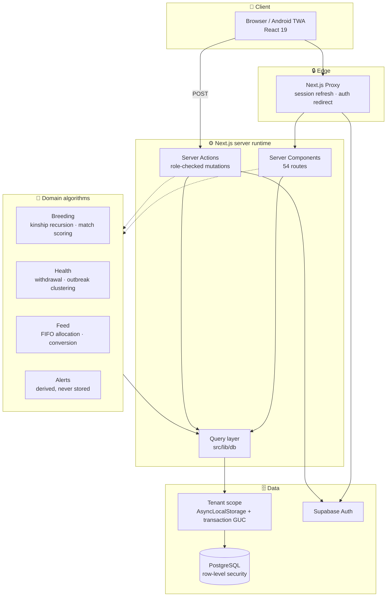

# Animal Farm Management

`Next.js 16` `React 19` `TypeScript` `PostgreSQL` `Prisma` `Supabase` `Tailwind 4` `Multi-tenant SaaS` `Row-Level Security` `Built with Claude Code`

> 💡 **Elevator pitch**
> A multi-tenant livestock platform that refuses the breeding decisions that quietly ruin a herd, blocks the animal sales that break food-safety law, and tells a smallholder what a kilogram of weight gain actually cost them.

---

## 1. Project summary and core value

### The problem

Smallholder mixed farms run several species at once: pigs, goats, poultry, catfish, snails, rabbits. Records live in notebooks and memory, which produces four failures that compound quietly.

| Failure | Why it happens | What it costs |
| --- | --- | --- |
| Inbreeding creeps in | No written pedigree, so a boar eventually serves his own daughter | Smaller litters, weaker young, a herd losing vigour |
| Withdrawal periods missed | Paper records lose track of which animal is still on antibiotics | Drug residue in meat; a legal and safety breach |
| Feed cost unmeasured | Feed is 60–75% of cost but the hardest thing to attribute | No idea which enterprise is actually profitable |
| One species' rules applied to all | A goat gestates 150 days, a pig 114 | Every projected birth date wrong by weeks |

### Target user

Smallholder and mid-size mixed farms, primarily in West Africa. The operator is on a low-end Android phone, one-handed, in a barn, often on intermittent data. Secondary users are farm staff, a visiting veterinarian, and whoever does the books.

### Tech stack

| Layer | Choice | Reasoning |
| --- | --- | --- |
| Framework | Next.js 16, App Router | Server Components by default; the phone does as little work as possible |
| Language | TypeScript 5 (strict) | The domain has many near-identical numeric fields; types catch the swaps |
| UI | React 19, Tailwind CSS 4 | Dark mode throughout, mobile-first, no component library |
| Database | PostgreSQL via Supabase | Recursive pedigree queries and row-level security |
| ORM | Prisma 6 | Typed queries and versioned migrations |
| Auth | Supabase Auth | Sessions refreshed in Next.js Proxy (formerly Middleware) |
| Authorisation | Four app roles + Postgres RLS | Enforced in every Server Action *and* by the database |
| Charts | Inline SVG | Zero charting dependencies |
| Tests | Node test runner via `tsx` | 56 domain tests, no framework |

**Scale:** 54 routes · 34 models · 30 enums · ~36,000 lines · 56 tests · 34 commits

---

## 2. Architectural and technical highlights

> ⚠️ **The specification was wrong about its own domain**
> The written requirements stated farrowing follows breeding by "~21 days". That is the **estrus cycle**, not gestation, which is ~114 days in pigs. Implementing it literally would have misdated every birth projection by roughly 13 weeks. Caught by reading the spec against the biology instead of treating it as authoritative. Gestation is now a per-species value: 114 for pigs, 150 for goats, 283 for cattle.

<details>
<summary><strong>Deep dive: choosing an algorithm that stays correct under pressure</strong></summary>

Inbreeding is computed through the **coancestry (kinship) recursion**, not by enumerating pedigree paths:

```
f(i, i) = ½ · (1 + F_i)
f(i, j) = ½ · (f(sire_i, j) + f(dam_i, j))   expanding the younger animal
f(i, j) = 0                                   if either animal is unknown
F_x     = f(sire_x, dam_x)
```

Mathematically equivalent to the textbook path formula, but linear in pedigree size once memoised. Path enumeration explodes combinatorially on exactly the line-bred herds where the number matters most, and is easy to get subtly wrong when a common ancestor is itself inbred.

The tests pin coefficients that **genetics fixes independently of the implementation**: 0.25 for a full-sib mating, 0.125 for half-sibs, 0.0625 for first cousins, and 0.15625 for half-sibs through an inbred sire. That last case is the one naive path counting misses.

Unknown parents are treated as unrelated founders, which biases the coefficient **downward**. So the UI never shows it without pedigree completeness beside it: F = 0.00 on a 20%-complete pedigree means "we don't know", not "unrelated", and reading it as reassurance is how a gene pool closes unnoticed.
</details>

<details>
<summary><strong>Deep dive: three tracking modes, because the differences are structural</strong></summary>

Nobody names broiler #4,127. Forcing 500 birds into 500 rows would be possible and operationally useless.

| Mode | Animals | Model |
| --- | --- | --- |
| **Individual** | Pigs, goats, sheep, cattle | Named, pedigreed, weighed one at a time |
| **Batch** | Poultry, catfish, snails | Stocked and sold as a group; headcount **derived** from an append-only event log |
| **Hybrid** | Rabbits, grasscutters | Breeding females individual, growers counted |

A batch's headcount is the only number on the farm nobody observes. The event log is the authority and the cached count is a cache of it, written in the same transaction. When they disagree the UI **says so and offers to rebuild** rather than silently correcting, because drift means a write landed half-applied and quietly fixing it erases the evidence.

Species biology lives in rows, not code: gestation, estrus cycle, weaning age, body-condition scale (1–5 for pigs, **1–9 for cattle**), and the vocabulary a farmer uses. A goat *kids*; a pig *farrows*. Screens that know their species use its words; screens that span species use neutral ones.
</details>

<details>
<summary><strong>Deep dive: multi-tenant isolation the database enforces</strong></summary>

Every table carries a tenant key from the **first** migration. Retro-fitting one onto populated tables is the most expensive migration a system like this can face.

Isolation runs in two independent layers:

1. **Application** — every query resolves the caller's farm first
2. **Database** — Postgres RLS on every tenant table, `FORCE`d so it applies to the table owner too

The policy compares against a **transaction-local** setting, not a per-connection one. The app is serverless behind a pooler: connections are shared between requests, so a per-connection tenant would leak between farms, which is the exact failure the policies exist to prevent.

It **fails closed**. No tenant set means the comparison is NULL, and no row matches. A query that forgets its tenant returns nothing rather than everything.

**The trap that nearly shipped:** the policies were written, applied, and reported as active by the dashboard. Testing showed the app's role carried `BYPASSRLS` and walked straight through all of them: 28 animals visible with no tenant set. Enabling RLS then connecting as a role that ignores it is *worse* than leaving it off, because it manufactures false confidence. Fix: a least-privilege role plus `npm run verify:tenant`, which **asserts** the three properties rather than assuming them.
</details>

<details>
<summary><strong>Deep dive: rules that are enforced, not displayed</strong></summary>

**Medication withdrawal** is a hard stop, not a notice. `assertAnimalsMayBeSold()` throws rather than returning a boolean, because a boolean can be ignored by a caller who forgets to read it, and it runs **inside the same transaction as the sale** so the check cannot be separated from the write it protects.

An off-by-one here is asymmetric: erring late delays a sale, erring early puts drug residue into the food chain. So the tests pin the boundaries, including a negative withdrawal period, because bad data must never make an animal *more* saleable than its own dose date.

**Breeding constraints** are hard or soft, never blended. A full-sib pairing must not become reachable by scoring well on everything else. Soft warnings require a recorded override reason, because "the only unrelated boar is 400 km away" is a real decision a farm makes and should be recorded rather than prevented.

**Feed allocation** draws oldest-delivery-first and **refuses rather than short-filling**. A record for less than was fed makes every downstream conversion ratio read better than reality.
</details>

---

## 3. AI-native build highlights

> 🤖 **Built end-to-end with Claude Code**
> Schema, domain algorithms, UI, auth, multi-tenancy and tests. What follows is an honest account of where that worked and where it did not.

### Where it clearly paid

**A 68-file rename, safely.** Generalising from pigs to any species meant `Pig` → `Animal` across ~1,000 occurrences: model names, relation names, camelCase identifiers, Prisma types, UI copy. Done as an ordered codemod with a typecheck after each pass, taking 87 errors to zero. By hand this is a day of work and a guaranteed missed case.

**Tests that pin invariants, not implementation.** The valuable tests here assert things the *domain* fixes independently of any code: 0.25 for a full-sib mating, mortality measured against everything ever stocked. Those survive refactors because they encode biology, not behaviour.

**Parallel module build.** Seven modules were dispatched concurrently against a shared schema contract. Honest result: **it hit rate limits repeatedly and was abandoned** for serial, then inline work. Parallel agents buy wall-clock speed but each starts cold and re-derives context, which is the more expensive path in aggregate.

### Where running the code found what review could not

> 🔬 **Typechecking proves shapes agree. Only execution proves the query is right.**

A verification script (`npm run verify`) exercises the engines against real seeded data. It found four defects that compiled perfectly:

| Defect | Why review missed it | Direction of the error |
| --- | --- | --- |
| Match finder offered a **rabbit** as a mate for a sow | Filtered on sex, status, purpose — never species | Ranked it *highly*: no shared ancestry reads as maximum diversity |
| Mortality reported at **half** its true value | Opening stock double-counted in the denominator | Flattering; nobody re-checks a low mortality rate |
| Feed conversion of **0.00** | No feed logged, so the ratio was zero | Reads as the best conversion ever achieved |
| Spurious "feed intake down 33%" alerts | Divided by a fixed window width, not days with data | False alarms train people to ignore the panel |

Each was found by a mixed-species demo herd. A single-species seed would have passed the first one indefinitely.

### Where it went wrong, and what that teaches

- A regex codemod **shadowed a variable** (`piglets` array and `piglet` loop var both became `offspring`) and broke JSX by putting template literals in attribute positions without braces. Mechanical edits need a compiler after every pass, not at the end.
- Making `prisma.ts` tenant-aware added a `server-only` import that broke a test file. It **did not fail loudly**: the run reported *46 passing instead of 56*, and a smaller green number looks like progress. Silent partial failure is the dangerous kind.
- A security audit of the author's own earlier work found a **cross-tenant data leak**: users without a farm fell through to "the oldest farm on the platform". Correct when there was one farm; a breach the moment there were two. Auditing your own output adversarially is not optional.

---

## 4. Architecture



### How a tenant-scoped read actually resolves

```mermaid
sequenceDiagram
    autonumber
    participant U as User
    participant P as Proxy
    participant S as Server Component
    participant T as Tenant scope
    participant DB as PostgreSQL

    U->>P: GET /animals
    P->>P: refresh Supabase session
    P->>S: forward
    S->>S: requireUser() → getActiveFarmId()
    S->>T: enterFarmScope(farmId)
    S->>T: prisma.animal.findMany()
    T->>DB: BEGIN; set_config('app.farm_id', …, true)
    DB->>DB: RLS policy filters to that farm
    DB-->>T: one tenant's rows only
    T-->>S: results
    S-->>U: rendered page
```

---

## 5. Screenshots

> 📸 **Regenerate these any time**
> ```bash
> npx playwright install chromium     # once
> npm run dev -- -p 3005              # in another terminal
> read -s -p "password: " FARM_PASSWORD && echo
> FARM_EMAIL=you@example.com FARM_PASSWORD="$FARM_PASSWORD" npm run capture
> ```
> Writes all seven images at 2880px wide into `assets/notion_portfolio/`. Ids for the pedigree, match finder and batch are discovered at runtime, so it keeps working after the demo data is reseeded.


*Four candidates refused, each with its reason: full siblings and parent-offspring at F = 25.0%, a half-sibling at 12.5% against the farm's 10% limit, and one too young at 87 days. A boar used twice this year carries a visible workload penalty and a "proceed only with a reason" gate. Anyone can list recommendations; showing why a candidate was refused is the part that has to be right.*


*The score is arithmetic, not a verdict. Genetic distance contributes 40 points, bloodline diversity 30, phenotype 16.8 of a possible 20, health history 10, with the sire-workload penalty applied after the weighted sum so the four published components still total 100.*


*Four generations, 6 of 30 ancestor slots recorded. The banner above the coefficient reads: "Unknown ancestors are assumed unrelated, so F is a floor, not a measurement — treat 0.00% as 'not yet known' rather than 'safe to breed'." Putting that caveat above the number rather than in a footnote is the difference between a figure that informs and one that misleads.*


*Sixteen live alerts, each naming its subject rather than its category. Two adjacent rows read "Doe not cycling" for a goat and "Sow not cycling" for a pig: species vocabulary comes from the species table, so the system never tells a goat keeper about farrowing.*


*Inbreeding distribution across the herd, average coefficient by birth year, and ancestor contribution. The last of those is the one that matters: F stays low while a herd quietly descends from the same few founders, so the report shows what share of the active population carries each ancestor.*


*A broiler flock: 482 of 500 alive, 3.6% mortality with 9 of the 18 deaths in week one, feed conversion 2.39, cost per kilogram of gain. The headcount is derived from an append-only event log rather than observed, and the mortality rate reported half its true value until the figures were checked against real data.*


*The same alert panel at 390px. This is the real form factor: one hand, in a barn, on a low-end Android.*


---

## 6. Status and what comes next

| Area | State |
| --- | --- |
| Domain engine, 54 routes, 56 tests | ✅ Built and verified against a live database |
| Multi-tenant schema, invites, RLS policies | ✅ Written and applied |
| RLS **enforcement** | ⏳ Awaiting a least-privilege role credential |
| Offline-first data entry | ⏳ Designed, not built. The real constraint for rural use |
| Audit logging | ⏳ Schema supports it; no write path yet |
| Play Store (TWA) and App Store | ⏳ Checklist written; PWA manifest still needed |

> 📌 **Deliberately not claimed**
> No machine learning and no LLM runtime integration. The breeding engine is deterministic genetics, which is the right call: a farmer refused a mating deserves an exact reason, and a food-safety block must be auditable rather than probabilistic. Claude Code built the system; it does not run inside it.
